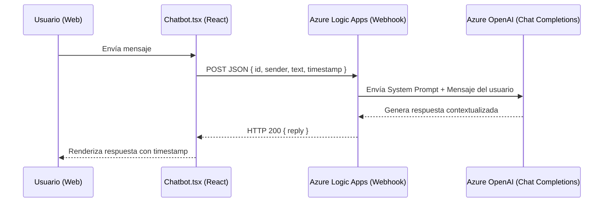

# 🤖 Asistente Virtual IA "Emma" — React + Azure OpenAI


Componente de asistente virtual corporativo desarrollado para brindar soporte de primer nivel, resolver dudas frecuentes sobre gestión de garantías y derivar requerimientos comerciales complejos a ejecutivos mediante WhatsApp.

> **Nota de seguridad:** Este repositorio contiene una versión extraída y sanitizada del módulo original desplegado en ambiente corporativo. Las credenciales, firmas SAS de Azure, IDs de suscripción y números telefónicos reales han sido reemplazados por variables de entorno y datos de demostración.

---

## 🏗️ Arquitectura y Flujo de Datos

El proyecto desacopla la interfaz de usuario de la lógica de IA utilizando una arquitectura *serverless* en Microsoft Azure:



## ✨ Características Principales

- **Interfaz moderna y responsiva:** Widget flotante construido con React, TypeScript y Tailwind CSS, con globo de bienvenida, indicador de escritura animado, auto-scroll y marcas de tiempo en formato local (`es-CL`).
- **Orquestación Serverless:** Flujo definido en Azure Logic Apps (`logic-app-openai.json`) que recibe peticiones HTTP, aplica *System Prompting* con reglas de negocio estrictas y consulta el despliegue de Azure OpenAI.
- **Derivación inteligente a WhatsApp:** Botón de acción directa (*"Hablar con un Ejecutivo"*) que implementa un algoritmo de asignación ponderada por peso para distribuir leads equitativamente entre el equipo comercial, prellenando el mensaje de contacto.

## 📁 Estructura del Proyecto

```text
asistente-virtual-ia-react-azure/
├── Chatbot.tsx             # Componente React autosuficiente (UI + lógica + estilos Tailwind)
├── logic-app-openai.json   # Definición del flujo de trabajo en Azure Logic Apps
└── README.md               # Documentación del proyecto
```

## ⚙️ Configuración y Uso

### 1. Frontend (`Chatbot.tsx`)

El componente utiliza Tailwind CSS y requiere configurar la URL del trigger HTTP de tu Logic App en un archivo `.env` en la raíz de tu proyecto React/Vite:

```env
VITE_AZURE_LOGIC_APP_URL=https://<tu-instancia>.logic.azure.com:443/workflows/...
```

Luego, impórtalo en tu aplicación:

```tsx
import Chatbot from './Chatbot';

function App() {
  return (
    <>
      {/* Contenido de tu sitio */}
      <Chatbot />
    </>
  );
}

export default App;
```

### 2. Backend (`logic-app-openai.json`)

Para replicar el flujo en Azure:

1. Crea una **Logic App (Consumption)** en Microsoft Azure.
2. En la vista de código (*Code View*), importa el contenido de `logic-app-openai.json`.
3. Reemplaza `<TU_SUBSCRIPTION_ID>` y `<TU_RESOURCE_GROUP>` por los valores de tu entorno y vincula tu conexión administrada de Azure OpenAI.

---

## 👨‍💻 Autor

**Luis Felipe Rivero Lagos**  
Analista Programador & Desarrollador de Software

[LinkedIn](https://www.linkedin.com/in/luisrivero3232) • [GitHub](https://github.com/gel32)
